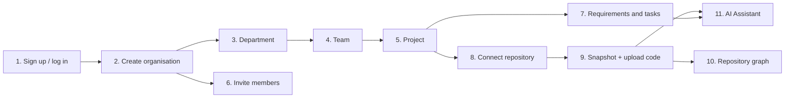

# ONE FOR ALL — User Guide

How to run the project and how to use it, step by step.

- [Part 1 — How to run the project](#part-1--how-to-run-the-project)
- [Part 2 — The complete working flow](#part-2--the-complete-working-flow)
- [Part 3 — Troubleshooting](#part-3--troubleshooting)

---

## Part 1 — How to run the project

### 1.1 What you need

| Tool | Why | Check |
| --- | --- | --- |
| Node.js 20 or newer | Runs the app | `node -v` |
| Docker Desktop | Runs the local Supabase database | `docker info` |
| Git | Gets the code | `git --version` |
| A Google Gemini API key (optional) | Powers the AI Assistant | [aistudio.google.com/apikey](https://aistudio.google.com/apikey) |
| A Gmail account with an app password (optional) | Sends invitation emails | [myaccount.google.com/apppasswords](https://myaccount.google.com/apppasswords) |
| `cloudflared` (optional) | Shares the app with people outside your network | `cloudflared --version` |

### 1.2 First-time setup (do this once)

**Step 1 — Get the code and install packages**
```bash
git clone https://github.com/Aariyan007/OneForAll.git
cd OneForAll
npm install
```

**Step 2 — Start Docker Desktop**, wait until it says it is running, then start the database:
```bash
npm run db:start
```
The first run downloads about 8 GB of images, so it can take several minutes. It creates the database and applies
every migration in `supabase/migrations`. At the end it prints the local URLs and keys.

**Step 3 — Create your settings file**
```bash
cp .env.example .env.local
```
Open `.env.local` and fill it in:

| Setting | Where to get it |
| --- | --- |
| `NEXT_PUBLIC_SUPABASE_URL` | Leave as `http://127.0.0.1:54321` |
| `NEXT_PUBLIC_SUPABASE_PUBLISHABLE_KEY` | Run `npx supabase status` and copy the **Publishable key** |
| `NEXT_PUBLIC_SITE_URL` | Leave as `http://localhost:3000` |
| `STRUCTURE_PERSIST_KEY` | Generate one (command below) |
| `INTEGRATION_ENCRYPTION_KEY` | Generate another one (command below) |
| `GEMINI_API_KEY` | Your Gemini key, for the AI Assistant (optional) |
| `SMTP_USER`, `SMTP_PASSWORD` | Gmail address and its 16-letter app password, for invitation emails (optional) |
| `APP_URL` | The address people open, if you share the app (see 1.5); leave empty for local use |

Generate a random key (run it twice, once for each key):
```bash
node -e "console.log(require('crypto').randomBytes(32).toString('base64url'))"
```

**Step 4 — Store the structure key in the database vault.** The database checks every repository upload with the same
key as `STRUCTURE_PERSIST_KEY`. Replace `YOUR_KEY` with the exact value you put in `.env.local`:
```bash
docker exec -i supabase_db_OneForAll psql -U postgres -d postgres -c "select vault.create_secret('YOUR_KEY', 'structure_persist_key', 'Structure and manifest HMAC key');"
```
If it says the secret already exists, update it instead:
```bash
docker exec -i supabase_db_OneForAll psql -U postgres -d postgres -c "select vault.update_secret((select id from vault.secrets where name = 'structure_persist_key'), 'YOUR_KEY');"
```

### 1.3 Start the app (every time)

1. Start **Docker Desktop**.
2. Start the database:
   ```bash
   npm run db:start
   ```
3. Start the app, either way:

   | Mode | Commands | Use it for |
   | --- | --- | --- |
   | Development | `npm run dev` | Coding; reloads on every change |
   | Production | `npm run build` then `npm start` | Demos and sharing; faster and stable |

4. Open **http://localhost:3000**.
5. Optional health check: **http://localhost:3000/api/health** should show `"status":"ok"`.

### 1.4 Stop the app

1. Press `Ctrl + C` in the terminal running the app.
2. Stop the database: `npm run db:stop`.
3. Quit Docker Desktop to free memory.

Your data stays in Docker's volumes and is there again next time.

### 1.5 Share it with someone outside your network (optional)

1. Start the app in production mode (1.3).
2. In another terminal:
   ```bash
   cloudflared tunnel --url http://localhost:3000
   ```
   It prints a link like `https://something.trycloudflare.com`.
3. Put that link in `.env.local` as `APP_URL=https://something.trycloudflare.com` and restart the app, so invitation emails
   point at it.
4. Send the link to your teammate. Your laptop must stay on and awake, with Docker running.

The link changes every time the tunnel restarts, and anyone who has it can open the sign-up page.

### 1.6 Run the tests

| What | Command |
| --- | --- |
| Unit tests (no network) | `npm test` |
| Database security tests (needs the database running) | `npm run test:sql` |
| Lint and types | `npm run lint` and `npm run typecheck` |
| Live AI evaluation (uses your Gemini quota) | `npm run ai:eval` |

---

## Part 2 — The complete working flow

The structure is: **Organisation → Department → Team → Project**. A project holds **requirements**, **tasks** and one
**repository**; the repository has **snapshots** (recorded versions of the code) that the **AI Assistant** works on.



### Step 1 — Sign up and log in
1. Open the app and click **Create account**.
2. Enter your name, email and a password (at least 8 characters).
3. You are signed in and land on the **Dashboard**. Next time, use **Sign in**.

> Locally, email confirmation is off, so you can use the account straight away.

### Step 2 — Create an organisation
1. On the Dashboard click **Create organization** (or **Organizations** in the left menu).
2. Type your company or college name and click **Create organization**.
3. You become its **Owner**. The organisation now appears in the workspace switcher at the top left.

### Step 3 — Create a department
1. In the left menu click **Departments** → **New department**.
2. Enter a name (for example *Engineering*) and an optional description → **Create department**.

### Step 4 — Create a team
1. On the department card click **View teams** → **New team**.
2. Enter a name (for example *Platform*) → **Create team**.

### Step 5 — Create a project
1. On the team card open **Projects** → **New project**.
2. Enter the name, an optional description and the project type → **Create project**.
3. The **project page** opens: requirements, repository and Repository Intelligence in one place.

### Step 6 — Invite your teammates
1. In the left menu click **Members**.
2. Enter their email and choose a role:
   - **Admin**: manages the organisation, members and projects.
   - **Employee**: works on the projects of the teams they belong to.
3. Click **Create invitation**. If email is set up they receive an email; otherwise copy the link shown and send it to them.
4. They open the link, **sign up or sign in with that same email address**, and click **Accept invitation**.
5. Give Employees access to projects: **Workforce** → open the person → set their **home team** → save. A member sees
   the projects of their home team (Owners and Admins see everything).

| Role | Can do |
| --- | --- |
| Owner | Everything, including organisation settings |
| Admin | Members, structure, projects, repository uploads, AI setting |
| Employee | Work on requirements and tasks of their teams' projects, use the AI Assistant |

### Step 7 — Add requirements and tasks
1. On the project page click **Requirements** → **New requirement**.
2. Give it a title, a description and a priority → **Create requirement**.
3. Open the requirement → **New task**. Add a title, acceptance criteria, estimate and due date.
4. On the task page:
   - **Assign** it to someone (or let the organisation's assignment policy suggest a person).
   - Move it through its states: **To do → In progress → In review → (In QA) → Completed**. Blocking or cancelling asks for a reason.
   - Add comments (mention people with `@`), links, dependencies and defects.
5. Assigned people see their work under **My work** and get **Notifications**.

### Step 8 — Connect the repository
1. On the project page, in the **Repository** section, click **Connect repository**.
2. Enter the provider, the repository URL, owner, name and default branch → **Connect repository**.

### Step 9 — Record a snapshot and upload the code
A snapshot is the code of one exact commit.

**Option A — upload a ZIP**
1. **Repository** → **Snapshots** → **New snapshot**. Enter the commit SHA and branch → **Create snapshot**.
2. On the snapshot page, upload a `.zip` of that commit (for example from `git archive --format=zip -o source.zip <commit>`
   or GitHub's **Download ZIP**). Limit: 8 MB.
3. The app records every file, stores the source text, and analyses the code structure.

**Option B — import from GitHub**
1. Project page → **Import from GitHub**, pick the branch and commit, and import. Public repositories need no token;
   private ones need a fine-grained token under **Integrations**.

Files such as `.env`, private keys and `node_modules` are skipped automatically and counted on the snapshot page.

> Snapshot recorded before the AI Assistant existed? Upload the same ZIP again on its page to store its source text.

### Step 10 — Explore the code structure
1. On a completed snapshot click **Repository Graph**.
2. See the files, classes, functions and methods, and how they contain or import each other. Search a symbol, click a
   node to focus on it, or open one file.

Supported languages: TypeScript, JavaScript, Python and Java.

### Step 11 — Use the AI Assistant
Open **AI Assistant** in the left menu (inside a project). Pick the snapshot, then a tab:

| Tab | What you do | What you get |
| --- | --- | --- |
| **Ask about the code** | Type a question, e.g. *"Where is the session expiry checked?"* | An answer with clickable file and line references |
| **Requirement ↔ code** | Pick a requirement (or use **Trace to code** on a requirement page) | The code that implements it, and the gaps |
| **Review / explain error** | Choose a file to review, or paste an error and stack trace | Findings with severity, location and a suggested fix |
| **Tests / docs** | Choose a file (and optionally a function) | A draft test or documentation file to copy or download |

- A run takes about 15–60 seconds; the progress panel shows each step, and **Cancel** stops it.
- Click a reference such as `src/auth/session.ts:1-7` to open the file with those lines highlighted.
- Every answer shows the model, tokens used and an estimated cost. Past runs are under **Recent runs**.
- Suggestions and generated tests are never applied to your code automatically; review them first.
- Questions and relevant code excerpts are sent to Google Gemini. Recognisable secrets are removed first.

### Step 12 — Organisation settings (Owner/Admin)
In the left menu click **Settings**:
- Rename the organisation.
- Choose the **assignment policy** (manual, recommend, or automatic).
- Turn the **AI assistant** on or off for the whole organisation.

### Where to find things
| I want to… | Go to |
| --- | --- |
| See my tasks | **My work** |
| See what changed for me | **Notifications** (bell icon) |
| Manage people and roles | **Members**, **Workforce** |
| See the organisation at a glance | **Overview** |
| Jump anywhere quickly | **Ctrl + K** |

---

## Part 3 — Troubleshooting

| Problem | Fix |
| --- | --- |
| `docker info` fails or `db:start` hangs | Start Docker Desktop and wait until it is running |
| Health check shows `"database":"unreachable"` | The database is stopped: `npm run db:start` |
| Uploads or analysis say the key is missing or rejected | `STRUCTURE_PERSIST_KEY` in `.env.local` and the vault secret differ; redo Step 4 of 1.2 and restart |
| AI Assistant says "not configured" | Add `GEMINI_API_KEY` to `.env.local` and restart the app |
| AI Assistant says "no stored source text" | Upload the same ZIP again on the snapshot page |
| An AI run is slow or falls back to a smaller model | Normal on the Gemini free tier when the main model is busy |
| Invitation email does not arrive | Check spam; check `SMTP_USER` / `SMTP_PASSWORD` (app password, not your Gmail password); you can still copy the link |
| Invitation link opens `localhost` for a remote person | Set `APP_URL` to the shared link (1.5) and restart |
| Shared `trycloudflare.com` link stopped working | Quick tunnels expire; start a new one and update `APP_URL` |
| An existing page shows "not found" in development | `npm run dev:clean` |
| `npm run build` says another build is running | `rm -f .next/lock`, then build again |
| Build fails with `os error 89` on a file | The project is in an iCloud-synced folder and macOS offloaded the file. In Finder, right-click the project folder → **Keep Downloaded**, or move the project out of Desktop/Documents |
